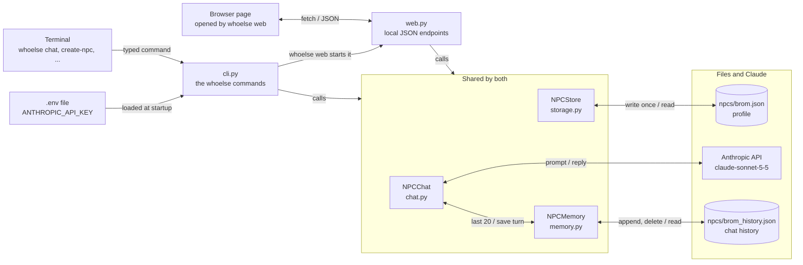
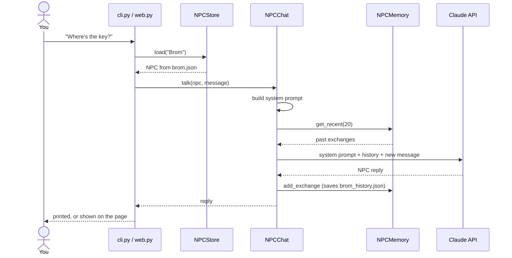

# WhoElse: NPC DM Helper

A command-line tool for Dungeons & Dragons Dungeon Masters. You create non-player
characters (NPCs) with a personality, voice, backstory, motivations and secrets,
then talk to them in character. Claude plays the NPC, and each NPC remembers
what has been said to it.

## What it can do

| # | Feature | Command |
|---|---------|---------|
| 1 | Create an NPC (name, personality, voice, and optionally backstory, motivations, secrets) | `whoelse create-npc` |
| 2 | Talk to an NPC with one message | `whoelse talk-to "Brom" "message"` |
| 3 | Hold a back-and-forth conversation until you type `quit` | `whoelse chat Brom` |
| 4 | List every saved NPC (secrets are never shown) | `whoelse list-npcs` |
| 5 | Erase one NPC's memory and keep its profile | `whoelse clear-memory "Brom"` |
| 6 | Do all of the above in a chat page in your browser | `whoelse web` |

What the NPC does with that information:

- **Stays in character.** Claude is told to answer only as the NPC and never to mention being an AI.
- **Acts on motivations.** Each motivation is something the NPC wants and pursues, even when nobody asks.
- **Guards secrets.** Secrets are sent to Claude with instructions to deflect rather than reveal them. The model can still slip, so treat this as a strong hint, not a guarantee.
- **Remembers the conversation.** Its last 20 exchanges are sent back with each new message, and they are saved to disk, so memory survives restarting the program.

## Setup (first time only)

You need Python 3.11 or newer and an Anthropic API key.

### Step 1: Get the code

```
git clone https://github.com/Jazny/WhoElse.git
cd WhoElse
```

### Step 2: Create a virtual environment

This keeps the project's packages separate from your other Python packages.

```
python3 -m venv .venv
source .venv/bin/activate
```

Your prompt should now start with `(.venv)`. You need to activate the environment
again in each new terminal (`source .venv/bin/activate`).

### Step 3: Install the project

```
pip install -e ".[dev]"
```

This installs the `whoelse` command, plus `pytest` for running the tests.

Run this command again whenever `pyproject.toml` changes after a `git pull`
(for example, when a command is renamed), so the installed command stays up to date.

### Step 4: Save your API key

Add your key to your shell profile once, so every new terminal has it.

- **macOS (zsh, the default):** open `~/.zshrc` in a text editor and add this line at the end:

  ```
  export ANTHROPIC_API_KEY=your-key-here
  ```

- **Linux (bash):** do the same in `~/.bashrc`.

Replace `your-key-here` with your real key. Then either open a new terminal, or
run `source ~/.zshrc` (or `source ~/.bashrc`) in the current one.

Never put the key inside the project folder or commit it to git.

### Step 5: Check the setup

```
echo $ANTHROPIC_API_KEY    # should print your key, not an empty line
whoelse --help              # should list the six commands
whoelse list-npcs           # should show "Brom: Grumpy, suspicious tavern keeper..."
```

If `whoelse` is not found, the virtual environment is not active. Run
`source .venv/bin/activate` again.

## How to use it

**Always run commands from the `WhoElse` folder.** NPCs are saved in the `npcs/`
folder inside wherever you run the command. Running from another folder creates
a new, empty `npcs/` there and the existing NPCs will not appear.

### Create an NPC

```
whoelse create-npc
```

The program asks, one line at a time:

1. **Name** (required). If the name is already taken, the command stops right away.
2. **Personality** (required), for example `Nervous scholar who hides a debt`.
3. **Voice** (required), for example `Quick, fidgety, talks over people`.
4. **Backstory** (optional). Press Enter to skip.
5. **Motivations** (optional). Separate several with `;`, for example `Pay the debt; Keep the library open`.
6. **Secrets** (optional). Separate several with `;`, for example `Stole the book he is hiding`.

Press Enter on any optional question to skip it. Then it prints `Saved <name>.`

Overwriting an existing NPC is not supported. To replace one, delete its file
(`npcs/<name>.json`) and its history (`npcs/<name>_history.json`) by hand, then create it again.

### List NPCs

```
whoelse list-npcs
```

Prints each NPC's name and personality. Secrets, motivations and backstory are not shown.

### Talk to an NPC once

```
whoelse talk-to "Brom" "What's in the cellar?"
```

Prints the NPC's reply. The name is not case-sensitive, so `brom` works too.
Each call is remembered, so the next call continues the conversation.

### Chat back and forth

```
whoelse chat Brom
```

An example session (Brom's wording will differ each time):

```
Talking to Brom. Type 'quit' to finish.
You > What's in the cellar?
Brom: *grunts* Rats, stranger. Nothing worth your time.
You > Are you sure?
Brom: ...
You > quit
Goodbye from Brom.
```

- Type a line and press Enter to send it.
- Blank lines are ignored.
- Type `quit` (any capitalization) to finish. Ctrl-D also finishes.
- If a reply fails, for example because you are offline, you see an `Error:` line and the chat continues.

### Erase an NPC's memory

```
whoelse clear-memory "Brom"
```

Deletes the NPC's conversation history and keeps its profile, so the NPC starts
fresh but keeps the same personality and secrets.

### Use the chat page in your browser

```
whoelse web
```

This starts a small web page on your own computer and opens it in your browser
(at `http://127.0.0.1:8000/`). From the page you can:

- Pick an NPC from the list on the left and chat with it. Past conversation is shown.
- Create a new NPC with **New NPC** (the same fields as `create-npc`).
- Erase the NPC's memory with **Clear memory**.
- See everything you entered about an NPC: hover over its name, click the **⋯**
  button, then **View character information**. This box does show secrets,
  so close it before turning the screen toward your players.

It uses the same NPCs, memory and Claude settings as the commands above, so you
can switch between the page and the terminal freely. Secrets are never shown in
the NPC list, only in the character information box. Press Ctrl-C in the terminal to stop it.

Options: `--port 8001` uses another port (if 8000 is busy), and `--no-browser`
skips opening the browser. The page is only reachable from your own computer.

## Errors you may see

Each error is one plain sentence, with no traceback:

| Message | What to do |
|---------|------------|
| `No NPC named 'X'. See saved NPCs with: whoelse list-npcs` | Check the spelling with `list-npcs`, or create the NPC. |
| `An NPC named 'X' already exists. Overwriting is not supported.` | Choose another name. |
| `ANTHROPIC_API_KEY is not set...` | Complete Step 4, then open a new terminal. |
| `Error: <message>` during a chat | Usually a connection or key problem. Check your internet and key. |

## Settings

These live in `npc_dm/config.py`:

| Setting | Current value | Meaning |
|---------|---------------|---------|
| `MODEL_NAME` | `claude-sonnet-5-5` | Which Claude model plays the NPCs |
| `MAX_REPLY_TOKENS` | `400` | Longest reply Claude may write |
| `MAX_HISTORY_EXCHANGES` | `20` | How many past exchanges each new message includes |
| `DATA_DIR` | `npcs` | Where NPC profiles and histories are saved |

Edit the file and run the command again. No reinstall is needed.

## Files

Saved data lives in `npcs/`, as plain JSON you can open and read:

- `npcs/<name>.json`: the NPC's profile, for example `brom.json`.
- `npcs/<name>_history.json`: the conversation history, for example `brom_history.json`.

The repo includes `npcs/brom.json`, an example tavern keeper, so you can try the
commands right away.

## Folder layout

```
WhoElse/
├── README.md              <- you are here
├── LICENSE
├── pyproject.toml         <- project metadata and dependencies
├── npc_dm/                <- the code
│   ├── config.py          <- settings: model name, data folder, history limit, reply cap
│   ├── models.py          <- data classes: NPC, Exchange
│   ├── storage.py         <- NPCStore: saves and loads NPC profiles
│   ├── memory.py          <- NPCMemory: saves and loads chat history
│   ├── chat.py            <- NPCChat: builds the prompt and calls Claude
│   ├── cli.py             <- the whoelse commands
│   ├── web.py             <- the local web server behind `whoelse web`
│   └── static/index.html  <- the chat page
├── npcs/                  <- saved profiles and histories, as JSON
│   └── brom.json          <- example NPC
└── tests/                 <- one test file per module, plus shared helpers
    ├── fakes.py           <- a stand-in for the Claude client
    ├── conftest.py        <- shared test fixtures
    ├── test_models.py
    ├── test_storage.py
    ├── test_memory.py
    ├── test_chat.py
    ├── test_cli.py
    ├── test_web.py
    └── test_integration.py
```

## How the pieces connect

Both ways in, the terminal and the chat page, use the same three classes.



When any `whoelse` command starts, `cli.py` copies the key from `.env` into the
environment (a key already exported in your shell wins). `NPCChat` reads it from
there, so a missing key only shows up when you send a message. Profiles and
histories are separate files on purpose: clearing memory never touches the NPC.

### One chat message, step by step



The system prompt is built from the profile: personality, voice, backstory,
motivations, secrets, and rules for guarding secrets and staying in character.
The exchange is saved only after Claude answers, so a failed call leaves the
history unchanged. The terminal shows an `Error:` line and the chat continues;
the page gets the error text back.

### Every action, both ways

| Action | Terminal | Chat page request | Files touched |
|--------|----------|-------------------|---------------|
| Create an NPC | `whoelse create-npc` | `POST /api/npcs` | writes `npcs/<name>.json` |
| List NPCs | `whoelse list-npcs` | `GET /api/npcs` | reads all profiles |
| View character information | (open the JSON file) | `GET /api/npcs/<name>` | reads the profile |
| Send a message | `whoelse chat` or `talk-to` | `POST /api/npcs/<name>/messages` | reads profile and history, appends to history |
| Open a past chat | (not needed) | `GET /api/npcs/<name>/history` | reads history |
| Clear memory | `whoelse clear-memory` | `DELETE /api/npcs/<name>/history` | deletes `npcs/<name>_history.json` |

`models.py` is used by everything. `config.py` holds shared settings.

## Running the tests

```
pytest
```

The tests never call the real API and never touch the real `npcs/` folder. Two
tests call Claude for real and run only when `ANTHROPIC_API_KEY` is set. Their
results depend on the model and can vary between runs.

## Future Features

- **Optimize communication to Anthropic API.** Currently, each message sends a request to Anthropic's Messages API and carries 4 things: the model name, a reply-length cap, the system prompt (character briefing), and the message from the sender. Look into optimizing this process.
